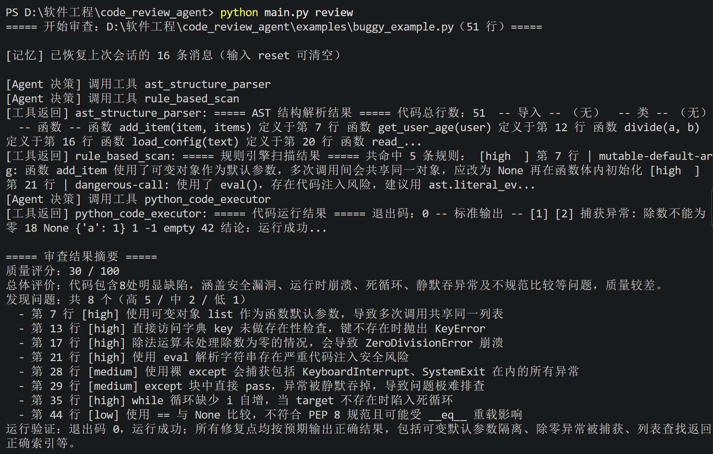
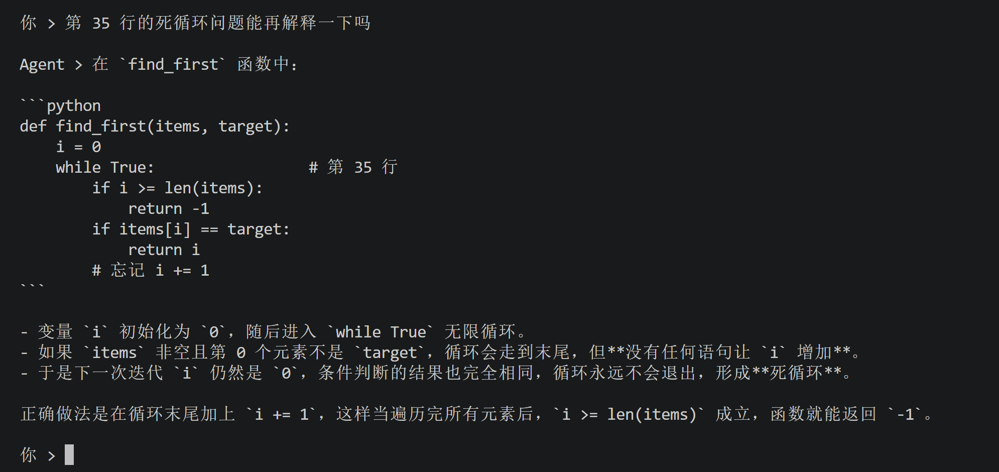
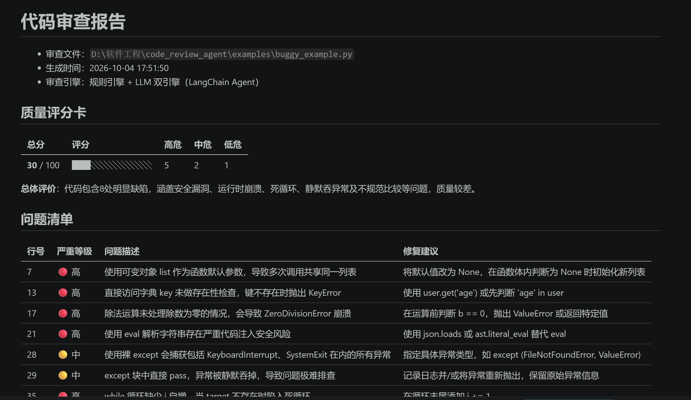

# Code Review Agent —— 双引擎代码审查智能体

一个基于 **LangChain + LLM** 的课程作业项目：接收 Python 代码，按照
「输入 → 推理 → 工具调用 → 输出」的 Agent 循环完成代码审查，
采用 **规则引擎 + LLM 双引擎**，不仅能发现缺陷，还能自动修复并**运行验证**修复效果。

## 功能特性

- AST 解析：提取代码结构（函数 / 类 / 导入），发现语法错误
- 规则引擎：扫描低级 bug（eval 滥用、裸 except、可变默认参数、== None、死循环等）
- LLM 深度分析：逻辑漏洞、边界条件、安全问题，结构化输出 bug 位置、严重等级、修复代码
- 自动修复 + 运行验证：在子进程中真实执行修复后代码，验证可运行
- 质量评分卡 + Markdown 审查报告自动生成
- 多轮追问：保留对话上下文，可针对报告继续提问
- 记忆持久化：对话记录自动保存到 memory.json，重启程序后自动恢复，输入 `reset` 清空
- 异常捕获 + 指数退避重试机制
- 边界处理：文件不存在 / 空文件 / 超大文件 / 编码错误、未配置 API Key 时均给出明确提示并优雅退出
- 单元测试：`tests/` 覆盖三个工具与 JSON 解析的正常与异常路径

## 项目结构

```
code_review_agent/
├── main.py                  # 命令行入口
├── requirements.txt
├── .env.example             # API 配置模板
├── agent/
│   └── review_agent.py      # LangChain Agent 主循环、记忆持久化、重试
├── tools/
│   ├── ast_parser.py        # 工具1：AST 结构解析
│   ├── rule_scanner.py      # 工具2：规则引擎扫描
│   └── code_runner.py       # 工具3：子进程运行代码验证
├── report/
│   └── report_generator.py  # 结构化输出解析 + Markdown 报告
├── examples/
│   ├── buggy_example.py     # 测试用例1：含 8 个典型 bug
│   └── clean_example.py     # 测试用例2：基本良好的代码（验证不误报）
├── tests/
│   └── test_tools.py        # 单元测试（unittest，不依赖网络与 API Key）
├── images/                  # 运行截图
├── reports/                 # 运行后自动生成报告到这里
└── memory.json              # 运行后自动生成（对话记忆，reset 可清空）
```

## 快速开始

```bash
# 1. 安装依赖（建议 Python 3.10+，可先创建虚拟环境）
pip install -r requirements.txt

# 2. 配置 API Key：复制 .env.example 为 .env，填入你的 Key
cp .env.example .env

# 3. 审查内置示例代码
python main.py review examples/buggy_example.py

# 4. 审查自己的代码文件
python main.py review path/to/your_code.py
```

审查结束后会自动进入多轮追问模式，输入 `exit` 退出、`reset` 清空记忆。

## 运行测试

```bash
python -m unittest discover -s tests -v
```

## 运行效果







## .env 配置说明

支持任何 OpenAI 兼容接口（Moonshot Kimi / DeepSeek / 通义 / OpenAI 等）：

```
LLM_API_KEY=sk-你的key
LLM_BASE_URL=https://api.moonshot.cn/v1
LLM_MODEL=kimi-k2.6
```

## Agent 工作流程

```
用户输入代码
   │
   ▼
Agent 推理：决定调用哪些工具（自主选择，非固定流程）
   ├── ast_structure_parser   → 代码结构 / 语法错误
   ├── rule_based_scan        → 规则命中的低级 bug
   └── python_code_executor   → 运行修复后代码，验证可执行
   │
   ▼
LLM 综合工具结果深度分析 → 结构化 JSON 输出
   │
   ▼
报告生成器解析 JSON → 评分卡 + Markdown 报告
   │
   ▼
多轮追问（保留上下文记忆）
```

## 设计文档要点（答辩用）

1. **Agent 循环**：基于 LangChain 1.x 的 `create_agent` 实现「推理 → 工具调用 → 观察 → 再推理 → 输出」循环，
   工具由 LLM 自主选择调用，体现智能决策而非硬编码流水线。
2. **双引擎**：规则引擎保证确定性、秒级发现低级问题；LLM 负责语义级深度分析，两者互补。
3. **验证闭环**：修复代码不直接采信，必须经 `python_code_executor` 真实运行验证。
4. **健壮性**：LLM 调用失败指数退避重试（最多 3 次）；工具内部全部 try/except，
   任何异常都作为文本返回给 Agent 而不是崩溃；JSON 解析失败有降级结构兜底。
5. **记忆**：完整 `messages` 消息列表随每轮对话累积传入，并持久化到 `memory.json`，
   程序重启后自动恢复上下文，支持针对报告的连续追问。
